<p align="center">
  <a href="https://www.forumvisionaria.it/">
    
  </a>
</p>

<h3 align="center">Tre giorni. Un porto sull'Adriatico. Un'idea di viaggio che non va di fretta.</h3>

<p align="center">
  
  
  
  
</p>

---

### 🐢 ⚡ Il paradosso

Il turismo lento, costruito a velocità folle.

Gruppi di persone che **non devono saper programmare**. Un agente AI a cui si parla **in italiano**.
Tre giorni per passare da *"e se…?"* a qualcosa che si apre dal telefono.

Cosa ne uscirà, ancora non lo sa nessuno. Nemmeno noi.

### 🗓️ Come va a finire

```text
 25.11  ●──────────  si parte
 26.11  ●●●●●●●●●●  si costruisce
 27.11  ●──────────▶ Main Stage · pitch finali · premiazione
```

Il 27 novembre i gruppi salgono sul **Main Stage** di Visionaria e mostrano quello che hanno costruito. Dal vivo.

### 🔒 Qui dentro

I repository sono chiusi fino alla finale. Il lavoro dei gruppi si vede **sul palco**, non prima.

Volete sapere com'è andata? Seguite il forum e tornate qui dopo il 27.

---

<p align="center">
  <b>Parte di <a href="https://www.forumvisionaria.it/">Visionaria · Adriatic Innovation Forum</a></b><br>
  <sub>Camera di Commercio Chieti Pescara · Padiglione D. Becci, Porto Turistico Marina di Pescara</sub>
</p>

<p align="center">
  <sub>Azienda madrina dell'hackathon: <a href="https://www.oltrematica.it/">Oltrematica</a></sub>
</p>
